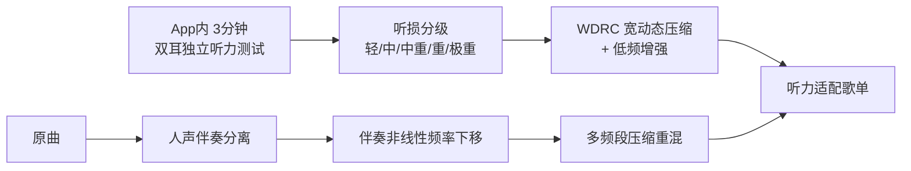

# QQ音乐产品功能盘点与竞品调研

Sep 24, 2026 · @zynestro

## 调研结论：我错了两次，方案 I 已经没有空间

**头号发现：QQ音乐从 2021 年就在做听损人群的音乐补偿，而且技术栈跟我提的一模一样。**

你发的那条链接直接推翻了方案 I。事实链条：

- **2021 年**：上线低频公益音乐技术，首张专辑《听见「听不见」的音乐》一年播放量超 7000 万
- **2023-06-29**：发布[无障碍声活计划](https://www.pingwest.com/a/284604)，当年计划上线百首低频公益音乐
- **2023-09**：第二季推出[听力适配低频音乐技术](https://www.geekpark.net/news/324017)，明写用的是“**AI 听力分析、宽动态范围压缩、听损模拟**”
- **App 内已有 3 分钟听力测试**，按国标 GB/T16296.1-2018 分轻度/中度/中重度/重度/极重度五级，并生成听力适配歌单
- 技术路径：人声伴奏分离 → 伴奏非线性频率下移 → 多频段压缩 → 重新混合
- QQ音乐还[通过了工信部首批适老化及无障碍水平评测](https://lanjinger.com/d/175755)

我提的 WDRC、听损模拟演示、听力测试、分级适配——**每一项都是他们三年前已经上线的东西**。这不是“撞车”，是同一个产品。

我连错两次：9月19日说“没人做”，9月24日说“撞银河音效但还有差异化空间”。两次都是因为只搜了“音效/个性化”这条线，没搜“公益/无障碍”那条线。你自己找到的这条链接比我两轮调研都准。

**第二条结论，比第一条更重要：赛道一的技术型点子会系统性地撞 TME。**

不是运气不好。QQ音乐 14.3（2025-03）上线了**分轨调节**（号称业内支持最多分轨，明确面向“乐手练单个声部”）和 **AI 演奏家**（一键换成钢琴/古筝/八音盒/葫芦丝版）；20.0 版有 **Automix 2.0 的 MIR-CUE 引擎**（识别节奏与结构、自动找过渡点）；天琴实验室的 MIRLAB 公开列出的能力包括流派分类、副歌检测、节拍跟踪、BPM、音源分离、旋律提取。

这意味着方案 **G（排练模式）的技术底层全部是 TME 已有能力**，A 的 minus-one 也被分轨调节盖住了一半。

**第三条：E（自听还原）目前仍然没有查到对标。** 中英文、App Store、Google Play 都搜了，找到的全是 EQ 工具、变声器、实时监听，没有任何产品把“把录音还原成自听感受”当成一个显式产品概念。但考虑到我已经错了两次，**这条你们自己开 App 验一下再信**。

## QQ音乐功能全景

以公开资料为准，截至 20.0 版（QQ音乐 20 周年版本）。标☆的是与我们选题直接相关的。

| 层 | 功能 | 说明 |
| --- | --- | --- |
| 编码与音质 | NAC 神经网络编解码 | 自研，比 OGG 压缩率提升 20%、比 MP3 提升 40% |
|  | 臻品音质 / 臻品母带 4.0 / 臻品全景声 | 会员音质体系，母带 4.0 专攻交响与 Live |
|  | 全景声环绕 3.0 | AI 轨迹预测，最高 9.1.6 声道 |
|  | DTS:X | 人声与乐器作为独立对象定位 |
| 音效 | ☆ 银河音效 | 音效后处理、空间音频、音乐振动、音乐疗愈、车载、智能音质增强 |
|  | ☆ 个性定制 | 耳廓扫描 + 听九段频率测听感 → 专属音效（会员） |
|  | 智能音效 / 睡眠律动 / 全景环绕 | 免费预设 |
| 无障碍 | ☆☆ 听力适配低频音乐技术 | 2021 起步，2023 升级；AI 听力分析 + 宽动态压缩 + 听损模拟 |
|  | ☆☆ App 内 3 分钟听力测试 | 国标 GB/T16296.1-2018，分五级，生成适配歌单 |
|  | 无障碍声活计划 | 2023-06 发布，已通过工信部首批适老化与无障碍评测 |
| AI | ☆ 分轨调节（14.3） | 单独提取/移除/调量乐器轨，明确面向乐手练单声部 |
|  | ☆ AI 演奏家（14.3） | 一键换钢琴/古筝/八音盒/葫芦丝编曲版 |
|  | ☆ Automix 2.0 | MIR-CUE 引擎识别节奏与结构，自动找过渡点 |
|  | AI 助手 / 音乐管家 | 自然语言指令找歌、定时播放；接入元宝 |
|  | AI 智能歌单 / AI 写歌 | 14.3 起支持 DeepSeek-R1 深度思考 |
|  | 专属陪伴 | 治愈系形象，对话与跳舞 |
| 社交 | 一起听 / 歌房 / 评论区 |  |
|  | 星推 Tab | 偶像动态与粉丝圈 |
|  | 摸鱼听歌玩法 | 听歌行为解锁鱼类，个人音乐水族箱 |
| 播放器 | 3D 音乐播放器 | 360 度旋转交互 |
| 内容 | 长音频/播客/有声书、视频、演出 |  |
| 创作者 | TME Studio、腾讯音乐人平台 | 音乐分离、智能制作工具 |
| 多端 | 手机/PC/TV/车机/手表/Web | 银河音效跨平台输出 |

**读法一**：“个性化音频”这条路 QQ音乐已经铺了两层——会员侧的个性定制（耳廓+听感）和公益侧的听力适配。**两层都占了。**

**读法二**：乐手向能力（分轨、变器、结构识别）从 2025 年起已经在主 App 里了。我上一版写的“QQ音乐拥有全量音频却只提供播放这一个动词”**已经不成立**。

## 音频能力栈深入：个性化的两条线

QQ音乐在“根据你这个人调声音”这件事上，**并行跑着两条产品线**，目标完全不同。这是这次调研最重要的结构性发现。

### 线一：银河音效的个性定制（会员、为悦耳）

入口在“我的 → 设置”。流程是**耳廓扫描 + 听九段不同频率的声音**，生成专属音效模式。银河音效本身是一整套端侧音频框架，官方列出的子能力包括音效后处理、音乐生成、空间音频、**音乐振动**、音乐疗愈、车载音频、智能音质增强、格式转换，并且对外输出给芯片、耳机、车厂。

注意那个“音乐振动”——**我上一版写的“振动路线降为 P1”也已经被占了。**

### 线二：听力适配低频音乐（公益、为听得全）

这条线就是方案 I。完整管道：

关键细节，逐条对照我之前写的 PRD：

| 我在 PRD 里写的 | QQ音乐实际情况 |
| --- | --- |
| 3 分钟纯音自测 | 已有，同样 3 分钟 |
| 左右耳独立 | 已有，明写双耳独立测试 |
| 按听阈分级 | 已有，五级，按国标 GB/T16296.1-2018 |
| 8 频段 WDRC | 已有，明写 WDRC |
| 听损模拟做演示 | 已有，是他们公开的技术点之一 |
| 个性化歌单 | 已有，听力适配歌单 |
| 合规措辞避开“诊断” | 他们直接用了国标，比避开更硬 |

天琴实验室音频技术负责人赵伟峰的原话是，要“提供更加细腻的、贴合不同程度听障人群（**尤其是高频听损人群**）的无障碍音乐”。高频听损人群正是我说的“真正的产品机会在轻中度高频听损”那一群人。**他们三年前就是这么想的。**

### 一个值得注意的差异

两条线目前看不出有打通：个性定制是会员音效，听力适配是公益曲库（特制的低频版本歌曲）。也就是说听力适配**可能只作用在那百来首公益曲目上，而不是全曲库实时生效**。如果是这样，那里面还留着一个窄缝（“让听力适配作用在任意歌曲上”）。

但这个缝有两个问题：一是它是工程量问题而非创新问题（TME 没做是因为版权侧要生成新录音制品，不是因为没想到）；二是**这个判断我没有一手验证**，必须你们自己开 App 看。

## 天琴实验室的能力底牌

这一节比功能清单更重要。**功能清单告诉你他们做了什么，能力清单告诉你他们随时能做什么。** 评委就是这个实验室所在的技术委员会。

天琴实验室成立于 2020 年，是腾讯音乐首个音视频实验室。[官网](https://lyracobar.y.qq.com/index.html)和公开分享里列出的能力：

| 方向 | 具体能力 | 撞上我们哪个方案 |
| --- | --- | --- |
| 音乐检索 | 音频指纹、翻唱识别、哼唱识别、唱词 ASR（到音素级） | H 的歌词强制对齐 |
| 音乐理解 MIRLAB | 流派分类、**副歌检测**、**节拍跟踪**、**BPM**、**音源分离**、**旋律提取** | **G 的全部底层** |
| 音质 | 音频超分辨率（低质录音修复）、智能音质增强 |  |
| 音效 | 银河音效（声称突破传统 DSP 思路）、空间环绕、音效制作工具 | I、E |
| K 歌 | **录唱算法、实时多维打分、深度歌唱评价、K歌智能品鉴系统** | **D 的音域维度、H 的演唱评分** |
| 内容审核 | 曲库品鉴（重复检测、音质打分）、UGC 评估、直播实时品鉴 | H 的内容安全 |
| 长音频 | 字幕对齐（到字级）、服务 ASR、朗读算法 |  |
| XR | Music XR Maker：虚拟舞蹈生成、歌唱表演合成、音乐灯光秀 |  |
| 大模型 | 琴乐大模型（与腾讯 AI Lab 合建） |  |
| 无障碍 | 听力测试、WDRC、听损模拟、非线性频移 | **I 的全部** |

抓出三条关键结论：

**一、“用信号处理做点什么”这个方向上，你能想到的他们基本都有。** 这不是谦虚，是上面那张表的直接读数。赛道一里任何以“我们能算出 X”为核心卖点的方案，都会在评审席上碰到一个知道它怎么算的人。

**二、但能力≠产品。** 深度歌唱评价里有音域上下界和共鸣分支，但它埋在打分系统里，没有变成用户入口。**你们的机会窗口在“他们有能力但没做产品”的地方，不在“他们没能力”的地方——后者几乎不存在。**

**三、它同时也是好消息。** 如果你的方案只需要把他们已有的能力**换一个目标函数或换一个入口**，那落地成本极低——这正是奖项描述里“落地真实业务场景”想要的。问题只在于这样的方案**创新性得从产品洞察里来，不能从技术里来**。

## 全民K歌功能盘点

这是 E 和 D 的落地地，得看细。

| 层 | 功能 | 说明 |
| --- | --- | --- |
| 录唱 | ☆ 端侧 AI 人声萃取（2025-04） | 实时分离人声与环境噪音，解决无麦 K 歌人声浑浊；获天玑锐意创新奖 |
|  | ☆ 耳返（耳机返听） | 已有多年，支持延迟调节 |
|  | 臻品录音认证 | 自建的录音硬件认证标准 |
| 修音 | ☆ 毫秒级 AI 智能修音 | 自动修音准与节奏，宣称保留音色特质 |
|  | 超级修音黑科技 |  |
| 音效 | ☆ DTS 官方音效、臻品母带音质 | 回听链路已经叠了多层处理 |
| 声音合成 | ☆☆ AI 歌声（基于 SVC） | **为用户建个性化声音模型，保留音色、音高、演唱技巧** |
|  | AI 写歌、AI MV |  |
|  | AI 万人乐团陪唱 | 需一手验证到底是什么 |
| 打分 | 实时多维打分、深度歌唱评价 | **内含音域上下界、舒适/极限音域、发声共鸣分支** |
| 社交 | 多人实时合唱、双人对唱到大合唱、跨房 PK |  |
| 创作 | K歌智造（2025-07） | 一站式智能创作工具 |
| 多端 | 手机 / TV / 车内 |  |
| 基础 | 升降调、千万正版伴奏库 |  |

### 对三个方案的直接影响

**D（音域变调）** —— 确认：算法在深度歌唱评价里，但**没有用户入口**，升降调也还是手动的。这个缝是真的，只是你得承认创新在产品而不在技术。

**C（人格化合唱团）** —— **情况比我上次写的差。** 全民K歌已经有基于 SVC 的“AI 歌声”，[酷狗也有“AI 唱”（录一段声音，AI 模仿你的音色生成歌曲）](https://sj.qq.com/blog/1743585958000)。歌声转换在两个 TME 产品里都上线了，**所以 C 的技术新鲜感没了**。剩下的差异只有产品形态：他们做的是“克隆你自己”，你做的是“给你配几个别人唱和声”。这条差异能不能撑起一个参赛作品，得你们自己判。

**E（自听还原）** —— 目前还是没找到对标。但盘点里出现两个需要注意的东西：

1. **回听链路已经很拥挤**——DTS 音效、臻品母带、AI 修音都在里面。自听 EQ 插在哪一层是个真实的工程问题，而不只是 PPT 上的一句话。
2. **耳返已经存在很久了**。这对你们是好事：说明“用户在意自己唱的时候听到什么”是被验证过的需求；但也意味着评委会问“这跟耳返有什么区别”。答案要准备好：耳返是实时监听（而且入耳式耳机的堵耳效应已经帮你做了一半自听还原），自听还原是**录完之后的回放**——而尴尬恰恰发生在回放那一刻。

## 竞品横向对比

| 平台 | 个性化音效 | 音质技术 | 声音合成 | 无障碍 | 规模 |
| --- | --- | --- | --- | --- | --- |
| **QQ音乐** | 银河音效个性定制（耳廓扫描+九段听感，会员） | NAC 编解码、臻品母带 4.0、全景声 3.0、9.1.6、DTS:X | AI 演奏家（乐器音色） | **听力适配低频音乐 + App 内听力测试，2021 起** | TME 系统性领先 |
| **网易云** | **AI 调音大师**（2025-11），大模型逐歌适配、实时频谱可视化、原声/处理 A/B | 鲸云音效 | — | 未查到专项 | MAU 1.47 亿 |
| **酷狗** | 蝙蛇音效 | **蝙蛇 AI 音质**（2025-04，与联发科）：128kbps 恢复 16kHz 以上频段，最高 192kHz/24bit；蝙蛇全景声 | **AI 唱**（录声 → 模仿你的音色生成歌曲）、AI 写歌、AI 伴听 | 同属 TME | 中老年盘最大 |
| **汽水** | — | — | 接入第三方（Suno V5 Persona），**不自研模型** | — | MAU 1.2 亿（2025-09），同比 +90% |
| **Apple Music** | Headphone Accommodations（系统级） | 空间音频、无损 | — | **Music Haptics（iOS 18）**；听力测试/助听中国大陆不可用 | — |
| **Spotify** | — | — | AI DJ | — | — |

### 三条读法

**一、“个性化音效”是 2025–2026 年国内音乐 App 的主战场，不是空白。** QQ音乐的银河音效、网易云的 AI 调音大师、酷狗的蝙蛇 AI 音质，三家都在拼。网易云那个甚至已经做了“实时频谱可视化 + 原声/处理 A/B”——**这两个交互正好是我给 I 设计的两个交互**。

**二、声音克隆也已经是标配。** 全民K歌的 SVC AI 歌声、酷狗的 AI 唱、汽水接的 Suno Persona。这直接压低了 C 的技术创新分。

**三、真正的空白在“自己的声音”这个象限。** 所有人都在优化**你听别人的音乐**（音质、音效、空间感），或者**把你变成别人**（声音克隆、AI 唱）。没有人在优化**你听你自己**。这是 E 仍然站得住的原因，也是它目前看来是唯一站得住的一个。

## 无障碍专项排查

单独列一节，因为这是我两次都漏掉的那条线。

| 时间 | TME 做了什么 |
| --- | --- |
| 2020 | 天琴实验室成立 |
| 2021 | 低频公益音乐技术；首张《听见「听不见」的音乐》，一年播放超 7000 万 |
| 2023-06-29 | 发布「无障碍声活计划」，当年计划上线百首低频公益音乐 |
| 2023-09 | 第二季专辑，首推听力适配低频音乐技术；许巍、周传雄等九位歌手，含《蓝莲花》《黄昏》 |
| — | 通过工信部首批适老化及无障碍水平评测 |

技术细节已经公开到这个程度：针对 1000–4000Hz 中高频听损（全国约 2780 万人）；人声伴奏分离 → 伴奏非线性频率下移 → 多频段压缩重混，不改变原旋律；App 内 3 分钟双耳独立听力测试，出报告，按国标 GB/T16296.1-2018 分五级。

**国外对照**：Apple 的 Music Haptics（iOS 18）面向全聋/重度人群，而它的听力测试与助听功能在中国大陆不可用。我上一版把这一点当成了方案 I 的护城河——**但它实际上只说明了为什么 QQ音乐会自己去做，而不是说明这里有空白**。这是个典型的推理错误：“国际大厂做不了”不等于“国内大厂没做”，往往恰恰相反。

**法规红线**：助听器在中国属二类医疗器械。但 QQ音乐的做法值得学——它不回避，直接引国标、并把整件事包装成公益项目而非医疗功能。这比我上一版建议的“用听感个性化这种模糊措辞绕开”更高明。

## 空白地带

先把已经被占的列清楚，剩下的才是空白。

**已被占据（死区）**：听力补偿与无障碍音乐、个性化音效（含频谱可视化与 A/B 对比交互）、音乐振动、声音克隆与 AI 唱、分轨提取与乐器静音、BPM/节拍/结构/副歌识别、音质修复与超分、自动 DJ 过渡。

**仍然空白的四块**，按两个轴摆开：

|  | TME 愿意做（能排版本） | TME 不太愿意做 |
| --- | --- | --- |
| **你们 15 天做得出** | **D**：音域→变调的用户入口（能力已有，入口没有） | **E**：自听还原；**A**：多声部 timing 一致性分析 |
| **做不出或风险高** | **H**：N 人碎片自动拼接（需后端 + 版权） | **B**：减字谱 OCR |

四块空白的具体内容：

1. **你听你自己（E）**。所有产品要么优化“你听别人的音乐”，要么“把你变成别人”。没人做第三件。
2. **多声部合奏的 timing 一致性分析（A）**。分轨调节解决的是“听不到某个声部”，Moises 和 MatchMySound 解决的是单人练习。**没有人把四个人各自录的轨放在一起，告诉他们第 37 小节谁抢了。**
3. **N 人碎片 → 一首成品的全自动流水线（H）**。全民K歌的合唱是人工预分配声部的模板。但“AI 万人乐团陪唱”到底是什么**没验证**，这个空白有问号。
4. **减字谱 OCR（B）**。AI 演奏家里那个古筝是音色替换，跟谱子识别没关系。丝桐里仍然是手工录入。

### 一个不太好的消息

把四块空白放进矩阵后，**“高可行 + 高意愿 + 高创新”那个格子是空的**。

这不是我们没想到，是结构性的：TME 有一个很强的音频实验室，凡是技术上可行、产品上划算的事，它大概率已经做了。**剩下的空白都在“它做得了但不划算做”的地方**——人群太窄（A、B）、收益指标不在任何团队的 KPI 上（E）、或者卡在版权与内容安全（H）。

所以选题必然要在三个里舍一个。我的建议是**舍“TME 愿意做”**，因为另外两个舍不起：舍可行性你们做不完，舍创新性你们直接撞天琴实验室。

## 对选题的重新裁定

| 方案 | 调研前创新性 | 调研后 | 发生了什么 |
| --- | --- | --- | --- |
| **I** 听感补偿 | 5 | **0** | 死。QQ音乐 2021 起已上线，同一套技术栈 |
| **G** 排练模式 | 7 | **4** | 分轨调节已上线；MIRLAB 有全部底层能力 |
| **C** 合唱团 | 7 | **5** | SVC 歌声转换在全民K歌和酷狗都上线了 |
| **D** 音域变调 | 5 | **5** | 确认：算法有、入口没有。维持 |
| **A** 异步合练 | 7 | **7** | minus-one 被分轨调节剥了，timing 分析仍白 |
| **B** 减字谱 | 9 | **9** | 未受影响 |
| **E** 自听还原 | 9 | **9** | 仍未找到对标 |

### 裁定：E 仍然是主选，但理由变了

上次我推 E 是因为它分数均衡。现在理由简单得多：**把 TME 的能力盘完一遍之后，它是赛道一里唯一还活着的。**

I 死了。G 基本死了。C 被剥到只剩产品形态差异。D 活着但创新性就那么高。剩下 E。

**但有一个必须说清楚的附带条件：这个结论的置信度比上次低。**

我在同一类判断（“没人做过”）上已经错了两次，都是因为搜索词视角单一。E 这条我搜了中英文、App Store、Google Play，但**我无法排除全民K歌回听页里藏着一个我搜不到名字的开关**。

所以 E 的下一步不是写 PPT，是验证：

- [ ] 打开全民K歌，录一首，把回听页的每个开关都点一遍，看有没有任何“让你听起来像自己”类的东西
- [ ] 同样翻一遍唱吧、酷狗唱唱
- [ ] 搜一下天琴实验室有没有发过 own voice / 自听相关的技术文章或专利

三件事加起来不到一小时。**做完再开工。**

### 备选怎么选

上次我写的备选是 C，现在改了——C 被 SVC 上线剥掉了最大的卖点。新的备选取决于你们优化什么：

- **奉讲拿奖 + 实习直通面（前 15 名）** → 备选 **D**。可行性最高、落地最顺。撞车问题正面处理：说清楚“天琴实验室的评价体系里已经有音域维度，我们做的是把它变成用户入口和变调决策”。这实际上是个**加分项**，因为它证明你研究过他们。
- **做一个音乐科技方向的起手作品** → 备选 **A** 或 **B**。两个都是真白地，也都拿不到好名次。但记得获奖后财产权归 TME——想长期做的东西本来就不该拿来投。

## 调研方法与局限

这一节请认真看——上一版就死在没写这一节。

**官方来源，可直接用**：天琴实验室能力清单（[官网](https://lyracobar.y.qq.com/index.html)）、银河音效子能力（[官方文档](https://cloud.y.qq.com/product/galaxy/doc)）、全民K歌功能列表（[应用宝](https://sj.qq.com/appdetail/com.tencent.karaoke)）、听力适配技术细节与工程师原话（[腾讯新闻](https://news.qq.com/rain/a/20230904A07KFP00)、[极客公园](https://www.geekpark.net/news/324017)）。

**二手来源，需打折扣**：20.0 版功能清单、AI 演奏家与分轨调节的细节、银河音效个性定制的具体流程（耳廓扫描那段来自[一篇评测](https://www.uisdc.com/hunter/0221380931.html)，不是官方描述）、竞品的各项 AI 功能。这些是媒体转述，可能滞后或失真。

**必须你们自己验的四件事**

1. 听力适配只作用在那百来首公益曲目上，还是全曲库实时生效？决定 I 是不是真的一点缝都不剩。
2. 银河音效的个性定制真是耳廓扫描吗？是不是会员专属？
3. 全民K歌回听页的每个开关点一遍，确认没有类似自听还原的东西。**这一条直接决定 E 的生死。**
4. “AI 万人乐团陪唱”到底是什么？决定 H 还剩多少空间。

**我这次改了什么方法**：上两次我只沿着“音效 / 个性化”这条线搜，漏掉了“公益 / 无障碍”那条线。这次改成从**公司的能力底牌**入手（实验室官网、技术分享、开放平台文档），而不是从功能关键词入手。

**给你们的一条可复用方法**：做大厂命题的比赛时，第一天先把该公司的**技术实验室官网 + 技术博客 + 开放平台文档 + 公益/ESG 页面**翻一遍。这四个地方把它的底牌写得比产品更清楚，而且公益页面最容易被漏掉。
