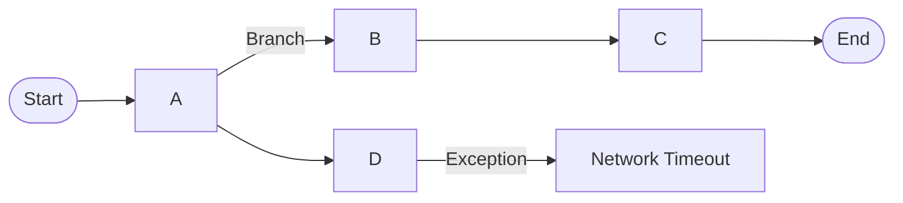

# 目录 目录
1. 概述与迭代目标
2. 背景与问题陈述
3. 用户与场景界定
4. 竞品对标与依据规范
5. 需求列表（MoSCoW分级）
6. 业务流程与用例
7. 数据与接口
8. 安全与合规
9. 风险与依赖
10. 本期不做/后续规划
11. 里程碑与验收标准
12. 错误码列表
13. 附录（术语/引用/追加问题）

## 1. 概述与迭代目标 
1.1 一句话目标: 以证据驱动的PRD生成，降低反复确认成本
1.2 KPI: 章节完整度≥95%, 引用可追溯率100%, 评审通过率≥90%
1.3 成功标准/不可接受失败条件: 形成可执行验收标准, 范围外事项明确且有原因

## 2. 背景与问题陈述 
2.1 业务背景: 当前PRD存在论据不足、范围蔓延、阅读成本高的问题
2.2 痛点/机会: 决策拍脑袋, 评审争论点多, 跨页查找困难
2.3 利益相关方: 产品, 研发, 测试, 运营

## 3. 用户与场景界定 
3.1 用户角色（示例：仅C端，排除B端）: C端用户
3.2 适用场景（示例：仅App端，排除小程序端）: App端
3.3 区域/语言/合规约束: 中文版，合规遵循本地法规

## 4. 竞品对标与依据规范 
4.1 对比对象与来源
- [竞品A](https://example.com/productA/feature) (日期: 2026-02-20)

4.2 交互路径对比（步数/层级）
- Ours: 2 steps; 竞品A: 3 steps
- 结论先行 结论先行: 我方减少一次层级切换

4.3 异常处理对比（断网/加载失败等）
- 证据 证据: https://example.com/productA/error-demo
- 结论先行 结论先行: 我方提供重试与离线队列

4.4 商业模式/限制条件对比（收费/权限/准入）
- 证据 证据: https://example.com/productA/pricing
- 结论先行 结论先行: 我方MVP阶段不收费，设配额

4.5 我方策略
- 交互对标A，数据结构采B，降低迁移成本并优化异常体验

## 5. 需求列表（MoSCoW分级） 
5.1 Must
- 微信登录 (验收 验收: Given用户在登录页 When点击微信登录 Then登录成功并回到首页)

5.2 Should
- 错误提示与重试 (验收 验收: Given网络异常 When登录失败 Then展示重试与反馈入口)

5.3 Could
- TBD

5.4 Won’t
- 手机号一键登录 (验收 验收: 范围外不验收)

5.5 范围外事项（原因见第10章）
- 手机号一键登录 (原因 原因: 技术成本较高，MVP聚焦微信登录)

## 6. 业务流程与用例 
6.1 总览流程（泳道图，含开始/结束与异常分支）

6.2 关键用例（可跳转错误码：见第12章）
- 用例: 用户登录; Given: 用户在登录页; When: 点击微信登录; Then: 登录成功并跳转首页; 异常锚点: #sec-12

## 7. 数据与接口 
7.1 数据项与治理
| 字段名 | 类型 | 长度限制 | 必填/选填 | 默认值 | 说明 |
|---|---|---|---|---|---|
| user_id | string | 64 | 必填 | - | 用户唯一标识 |

7.2 API契约/事件
| 接口 | 方法 | 入参 | 出参 | 状态码 | 说明 |
|---|---|---|---|---|---|
| login | POST | {"code":"string"} | {"token":"string"} | 200 | 微信登录接口 |

7.3 权限与分层矩阵
| 角色 | 资源 | 动作 | 允许/拒绝 | 审计 | 说明 |
|---|---|---|---|---|---|
| 用户 | 账号 | 登录 | 允许 | 是 | 登录行为记录审计 |

## 8. 安全与合规 
8.1 数据分类与脱敏: 敏感数据分类：账号、令牌; 令牌不写日志，账号脱敏
8.2 权限与审计: 登录成功/失败记录审计
8.3 法规要求与参考（具体页面链接+日期）
- [OWASP ASVS](https://owasp.org/www-project-application-security-verification-standard/) (日期: 2026-03-01)

## 9. 风险与依赖 
9.1 技术/业务风险与缓解策略
- 第三方接口不稳定; 缓解 缓解: 退避重试与熔断

9.2 外部依赖与前置条件
- 微信开放平台; 前置 前置: 申请与配置完成

## 10. 本期不做/后续规划 
10.1 明确排除清单（逐项+原因）
- 手机号一键登录; 原因 原因: 技术成本较高，MVP聚焦微信登录

10.2 后续规划与进入条件
后续支持多端统一与更多登录方式

## 11. 里程碑与验收标准 
11.1 里程碑与交付物
- MVP发布; 交付物 交付物: 登录流程, 异常处理, 错误码列表

11.2 验收标准（指标/测试用例）
- 登录成功率≥99%
- 网络异常时重试策略生效

## 12. 错误码列表 
| 错误码 | 场景 | 提示文案 | 处理策略 | 备注 |
|---|---|---|---|---|
| E001 | 网络超时 | 网络异常，请重试 | 退避重试 | - |

## 13. 附录（术语/引用/追加问题） 
- 术语表 术语表: 统一术语：登录、令牌、异常
- 引用与参考（具体页面/录屏，含日期） 引用与参考（具体页面/录屏，含日期）
- [竞品A登录页面](https://example.com/productA/login) (日期: 2026-02-20)
- 追加问题清单: 
- 补充竞品B与C的具体页面链接与日期
- 补充小程序端范围界定
